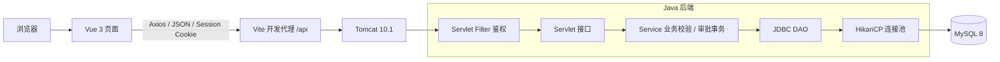
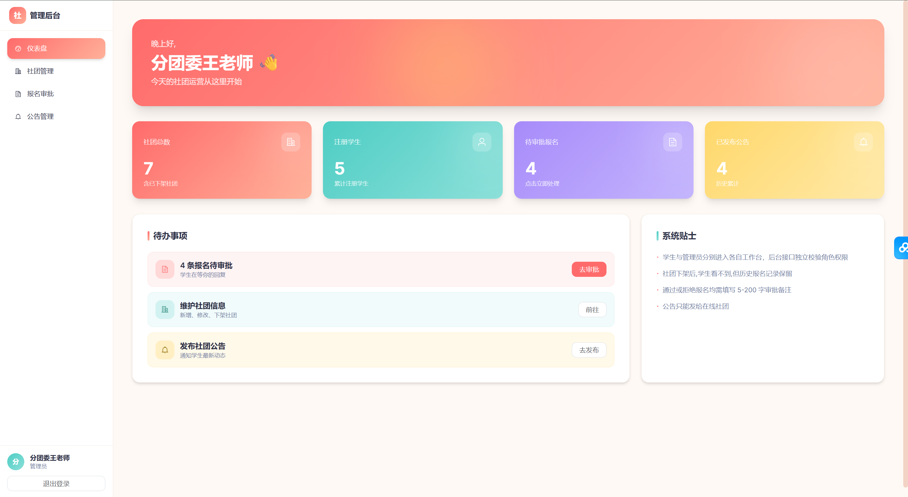
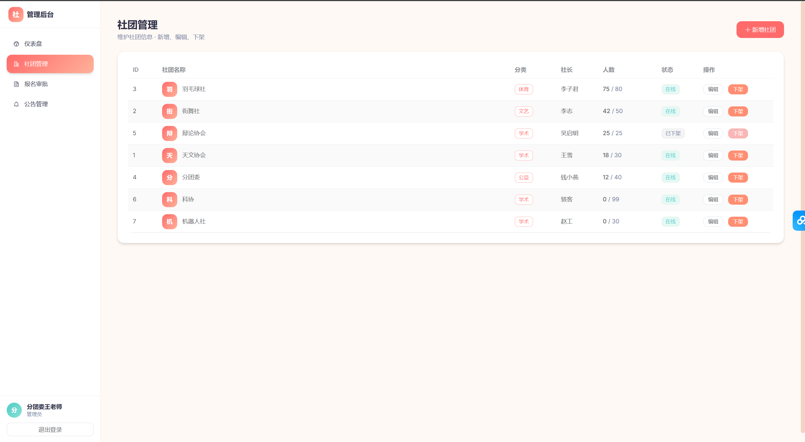
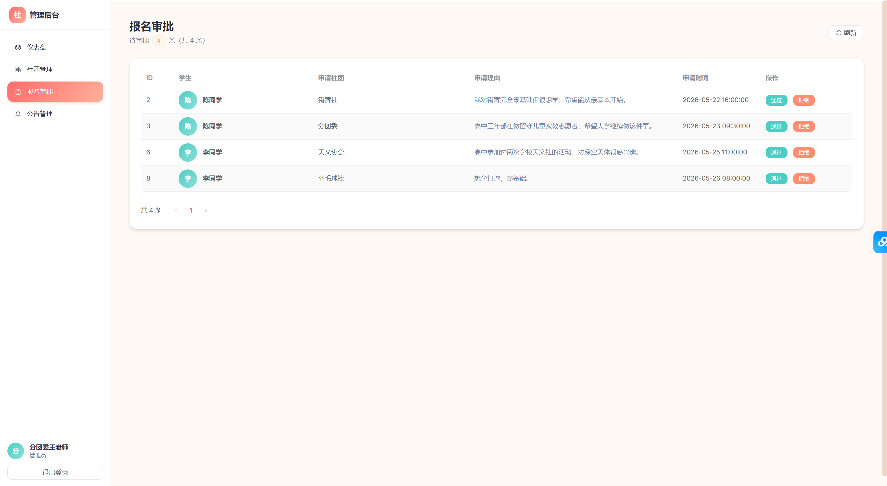
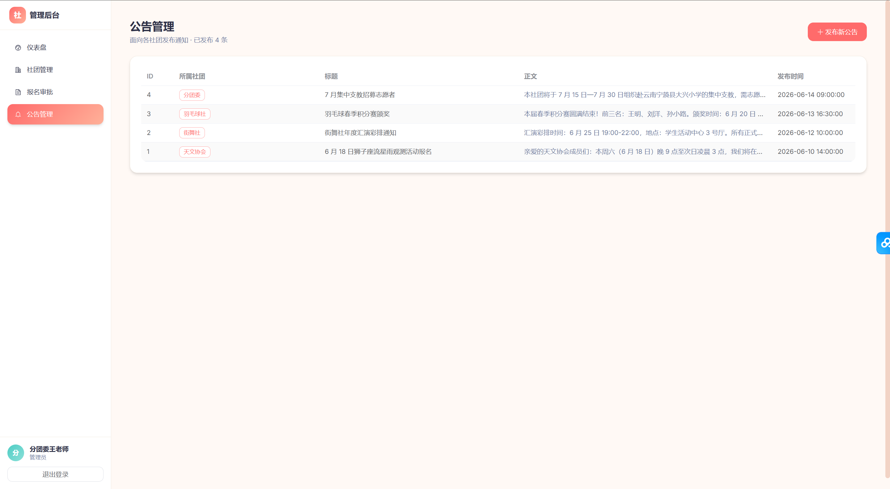
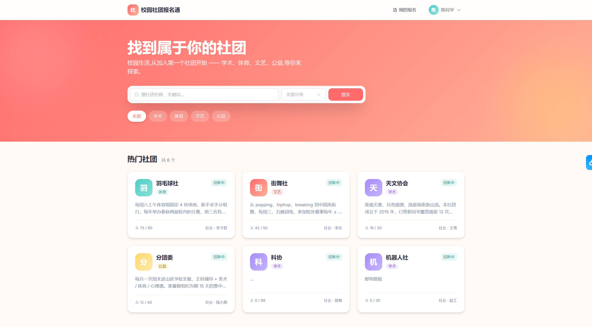
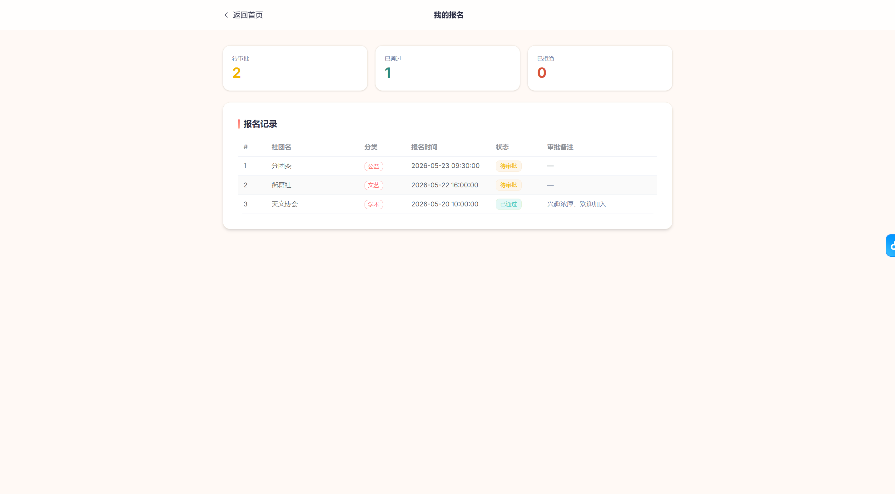

# 社团报名通 · 校园社团招新管理系统

一个前后端分离的社团报名与审批系统，覆盖社团浏览、在线报名、集中审批、结果查询、公告发布和统计仪表盘。

源于本人担任分团委主席期间的招新需求，解决 QQ 群报名入口不易获取、报名表分散和整理困难的问题。本人完成需求分析、原型设计、系统设计、前后端开发及测试；2026 年 8–9 月用于本社团招新，报名人数 100+，使用反馈为“比之前报名表的形式便捷”（实际使用信息由作者提供）。目前面向本社团，全校推广为后续计划。

## 技术栈

- 后端：Java 21 · Jakarta Servlet 6 · JDBC · MySQL 8 · HikariCP · Gson · BCrypt
- 前端：Vue 3 · Vue Router · Element Plus · Axios · Tailwind CSS · Vite 8
- 构建与运行：Maven · Tomcat 10.1

## 功能亮点

- **报名闭环**：学生浏览与筛选社团、提交申请、查询审批状态和备注，管理员集中处理报名。
- **双角色鉴权**：HttpSession + Servlet Filter 校验登录状态与接口权限，Vue Router 守卫控制页面访问，修复学生进入管理界面的问题。
- **审批一致性**：JDBC 事务同步更新报名状态与成员人数，结合 MySQL 状态、容量条件更新，防止重复审批和并发超员。
- **重复报名控制**：学生—社团联合唯一约束阻止重复报名；三表 JOIN 与后端分页支持待审列表查询。
- **账号安全**：BCrypt 随机盐保存密码，公开注册仅创建学生，管理员通过受控终端创建。
- **管理工作台**：支持社团新增、编辑、下架及公告发布，展示社团、注册学生、待审报名和公告数量。

## 项目架构



上图为本地开发架构。生产部署需要配置静态资源服务、API 反向代理和 Vue history 路由回退；Vite 开发代理不会随前端构建产物部署。

## 本地运行

### 环境准备

- JDK 21 或更高版本、Maven 3.9+、MySQL 8、Tomcat 10.1。
- Node.js 20.19+（20.x）或 22.12+。
- 执行 `mvn -version`，确认 Maven 使用的 Java 版本不低于 21。

### 数据库

1. 启动 MySQL，在 MySQL 客户端导入初始化脚本（从项目根目录启动客户端）：

   ```sql
   SOURCE sql/init.sql;
   ```

   **该脚本会删除并重建 `club_enroll`，仅用于可重建的开发库；已有报名数据时不要执行。**

2. 将 `backend/src/main/resources/db.properties.example` 复制为同目录 `db.properties`，填写数据库连接信息。

### 后端

在项目根目录的 PowerShell 中执行：

```powershell
cd backend
mvn package
if ($LASTEXITCODE -ne 0) { throw '后端打包失败，请检查 Maven 输出' }

# 修改为本机 Tomcat 10.1 的安装目录
$tomcatDir = 'D:\Daicx\实习简历\实习项目\.runtime\apache-tomcat-10.1.60'
$env:CATALINA_HOME = $tomcatDir
$env:CATALINA_BASE = $tomcatDir
Copy-Item '.\target\club-enroll.war' "$tomcatDir\webapps\club-enroll.war" -Force
& "$tomcatDir\bin\catalina.bat" run
```

保持终端运行，后端地址为 `http://localhost:8080/club-enroll`。Tomcat 9 不适用于本项目。

### 前端

另开终端，在项目根目录执行：

```powershell
cd frontend
npm ci
npm run dev
```

浏览器打开 `http://localhost:5173`。后端端口不同时，在 `npm run dev` 前设置：

```powershell
$env:CLUB_BACKEND_URL = 'http://localhost:18080/club-enroll'
```

### 旧账号迁移

旧版数据库使用明文密码时，新版无法直接登录。先备份数据库、停止后端，在完成打包后于项目根目录执行以下命令，再重启后端；原密码、角色及报名记录保持不变：

```powershell
java -cp "backend/target/classes;backend/target/club-enroll/WEB-INF/lib/*" com.club.util.AccountMaintenance migrate
```

## 演示账号

以下账号由初始化脚本提供，仅用于本地演示：

| 身份 | 用户名 | 密码 |
| --- | --- | --- |
| 管理员 | admin001 | admin123 |
| 学生 | chen | 123456 |
| 学生 | zhang | 123456 |
| 学生 | li | 123456 |

建议使用普通窗口和无痕窗口分别登录学生与管理员，演示“学生报名 → 管理员审批 → 学生查询结果”。

## 功能截图

以下为作者提供的功能演示截图，页面中的社团、人数和日期用于展示，不作为实际招新统计依据。

### 登录页面


### 管理员仪表盘



### 社团管理



### 报名审批



### 公告管理



### 学生首页



### 我的报名



