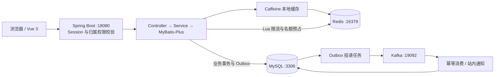

# 青聚 · 校园社团招新与活动预约平台

围绕校园社团招新和场馆参观活动开发的平台，采用 Vue 3 与 Spring Boot 前后端分离架构，面向学生、社团负责人和管理员，支持社团浏览、报名审批、活动发布、限额预约及站内通知。针对集中开放预约时的名额竞争，以及活动列表的重复查询，实现缓存、并发容量控制和事件可靠投递。

## 技术栈

- **后端**：Java 21 编译目标、Spring Boot 3.5.11、MyBatis-Plus 3.5.9、MySQL、Caffeine、Redis、Lua、Spring Kafka、BCrypt。
- **前端**：Vue 3、Vite、Element Plus、Vue Router、Axios。
- **测试与运行**：JUnit、Node.js 接口测试脚本、Postman、Maven、PowerShell；Python 用于本地数据库初始化和测试库准备。

## 功能亮点

- **角色与权限**：基于 Session 的登录认证，使用 BCrypt 保存密码；管理员授予学生指定社团的管理权限，后端校验社团归属。获得权限后展示负责人标识、管理入口及站内通知。
- **社团招新**：浏览社团、提交报名表、查询报名结果；负责人审批所属社团申请，事务内更新审批状态和成员数，限制重复报名及超额录取。热门社团按成员数排序。
- **活动预约**：负责人通过公告发布参观活动，设置容量及时间；学生提交学号、姓名预约，同一学号每场仅允许一个有效预约，截止前可取消并释放名额。参观预约不要求先通过入社审批。
- **热点查询缓存**：Caffeine + Redis 二级缓存，结合随机 TTL、版本失效和本地同键合并加载减少回源；限制并发回源数量，保护数据库。
- **并发名额控制**：Redis Lua 原子预占名额，MySQL 事务、容量条件及唯一约束完成最终确认；持久化预占状态，定时回收过期预占并核对 Redis 残留记录。
- **事件与通知**：业务事务内写入 Outbox，通过 Kafka 投递事件，失败后退避重试；消费端去重，生成预约、取消及授权变更等站内通知。

## 项目架构

以下为当前本地运行架构，前端构建产物随可执行 JAR 一起发布：



## 本地运行

当前启动脚本面向 **Windows PowerShell**，采用本机进程方式运行，未使用 Docker。需要 Java（编译目标 21，当前本机使用 Java 24）、Maven、Node.js 22.12+、Python 3，以及可用的 MySQL、Redis 和 Kafka。

### 1. 配置并初始化数据库

将 [db.properties.example](backend/src/main/resources/db.properties.example) 复制为同目录的 `db.properties`，填写自己的本地数据库连接信息：

```powershell
Copy-Item backend/src/main/resources/db.properties.example backend/src/main/resources/db.properties
```

启动 MySQL，将 `mysql.exe`、`mysqldump.exe` 加入 PATH。配置账号须具备初始化及备份所需权限，然后在项目根目录执行：

```powershell
python -X utf8 scripts/prepare-local.py
```

脚本生成 `.local/database.properties` 和本地客户端配置；已有数据库先备份，缺少基础表时初始化。应用启动时执行增量建表并记录版本。

**不要直接对已有业务数据库执行 `sql/init.sql`，其中包含重建数据库语句。**本地连接配置和备份均被 Git 忽略。

### 2. 准备 Redis 与 Kafka

- 本地脚本使用 Redis 端口 **16379**，默认可执行文件路径为 `D:\Redis-x64-5.0.10\redis-server.exe`；可通过 `-RedisExe` 指定实际路径。
- 将 Kafka **4.1.1** 的 `kafka_2.13-4.1.1` 发行包解压至 `.local/kafka_2.13-4.1.1`，确保其中存在 `libs` 目录。
- 脚本创建单节点 KRaft 配置，使用 **19092 / 19093** 端口；Redis 和 Kafka 数据保存在 `.local`。

启动脚本负责启动已准备好的中间件，不会自动下载安装。当前 Redis Windows 版本为本地开发环境配置。

### 3. 构建前后端

在项目根目录执行；重新构建前应先停止已运行的应用，避免 Windows 占用 JAR：

```powershell
cd frontend
npm ci
npm run build
cd ../backend
mvn package
cd ..
```

产物为 `backend/target/qingju.jar`，包含前端静态资源，无需额外启动前端服务器。

### 4. 启动应用

在项目根目录执行，将 Redis 路径替换为本机实际路径：

```powershell
powershell -NoProfile -ExecutionPolicy Bypass -File scripts/start-local.ps1 -RedisExe 'D:\Redis-x64-5.0.10\redis-server.exe'
```

打开 [http://127.0.0.1:18080](http://127.0.0.1:18080)。运行日志位于 `.local/logs`。

```powershell
# 停止应用，保留中间件
powershell -NoProfile -ExecutionPolicy Bypass -File scripts/stop-local.ps1

# 同时停止本项目启动的 Redis、Kafka
powershell -NoProfile -ExecutionPolicy Bypass -File scripts/stop-local.ps1 -IncludeMiddleware
```

## 本地初始账号

首次初始化数据库后可使用以下账号；已有数据库中的密码以实际设置为准。

| 角色 | 账号 | 初始密码 |
| --- | --- | --- |
| 管理员 | admin001 | admin123 |
| 学生 | chen | 123456 |
| 学生 | zhang | 123456 |
| 学生 | li | 123456 |

社团负责人由管理员从学生账号中授权，权限限定于指定社团。

## 接口与测试

Postman 请求集合：[qingju.collection.json](scripts/postman/qingju.collection.json)。操作步骤见 [Postman 测试说明](docs/postman-testing.md)。接口使用 Session Cookie 认证，生成的会话和环境文件位于 `.local/postman`，不提交到仓库。

### 自动化验证

构建完成且 MySQL、Redis、Kafka 可用后，在项目根目录执行：

```powershell
powershell -NoProfile -ExecutionPolicy Bypass -File scripts/run-boot-tests.ps1
```

脚本创建独立的 `qingju_test_*` 数据库和 Redis/Kafka 命名空间，在 **18081** 端口运行测试实例，结束后停止该实例。测试库保留供排查。覆盖报名审批、权限、名额竞争、重复消息、预占回收和限流等场景，详见 [验证记录](docs/verification-20261024.md)。

## 项目目录

```text
backend/       Spring Boot 源码、配置模板及单元测试
frontend/      Vue 页面、组件及构建配置
sql/           初始化与升级 SQL
scripts/       本地启动、测试库准备、接口测试及 Postman 集合
docs/          操作说明与验证记录
```

`.local/`、`.test-runtime/`、`target/`、`node_modules/`、前端构建产物和本地数据库配置已加入 Git 忽略规则。仓库保留源码、配置模板及可复现测试脚本；数据库备份、Cookie、运行日志和中间件数据留在本地。
